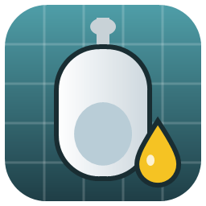
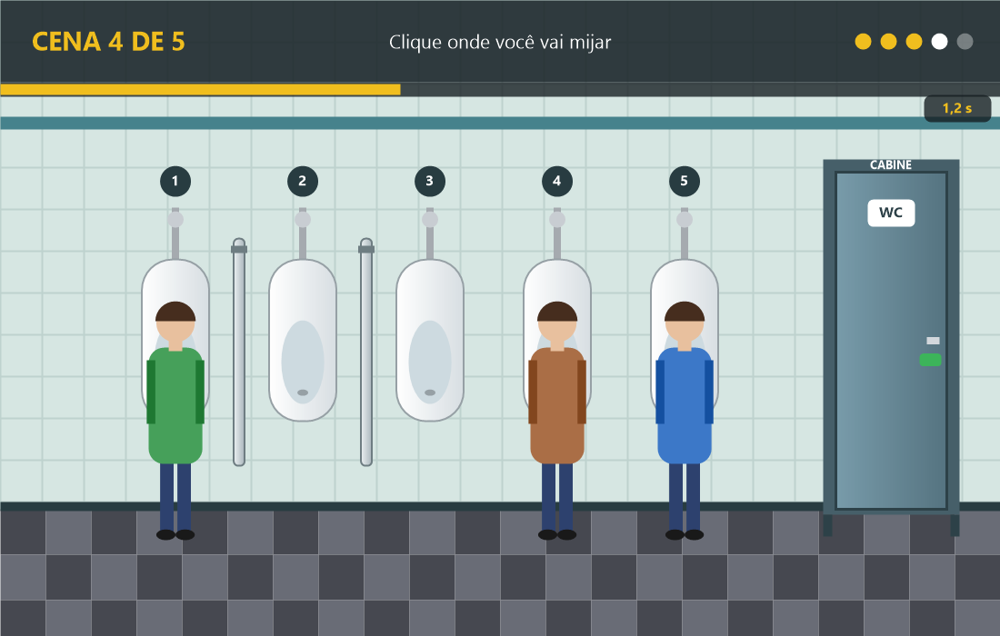

<p align="center"></p>

<h1 align="center">Jogo do Banheiro</h1>

<p align="center">
  <a href="https://github.com/maiconaltircanal/Jogo-do-Banheiro/releases/latest"><b>⬇ Baixar o instalador</b></a>
</p>



Jogo de PC (Windows) em que você entra no banheiro e escolhe onde vai mijar — contra o relógio.
São 5 cenas sorteadas a cada partida, com 2 a 10 mictórios:

- **1 banheiro vazio** — a ponta é o lugar certo; o do meio é coisa de quem se acha dono do banheiro.
- **1 com divisórias** — com a placa no meio, pode ficar do lado.
- **1 onde só a cabine salva** — todo mictório livre está colado em alguém.
- **2 normais** — às vezes com cabine como opção (e armadilha).

**Regra de ouro:** nunca fique colado em alguém sem divisória. É falta grave e reprovação direta.

### Pontuação (por cena, até 120)

| Escolha | Pontos |
|---|---|
| Mictório mais distante de todo mundo (ou a ponta, no banheiro vazio) | 100 |
| Seguro, mas não o melhor / salvo pela divisória | 70 |
| Banheiro vazio: um qualquer / o do meio | 60 / 30 |
| Cabine quando não havia mictório seguro | 100 |
| Cabine quando havia mictório seguro | 40 |
| Colado em alguém | 0 + falta grave |
| Tempo esgotado ("mijou na calça") | 0 |
| **Bônus "Decidido"**: escolheu na primeira metade do tempo | +20 |

O cronômetro começa em 6 segundos e cai um por cena (6, 5, 4, 3, 3).

### Ranking (até 600 pontos)

| Pontos | Título |
|---|---|
| 540+ | MACHO ALFA |
| 420+ | MACHO |
| 300+ | MACHO EM TREINAMENTO |
| 150+ | SUSPEITO |
| abaixo de 150 ou falta grave | reprovado |

## Instalar

1. Abra a página de [**Releases**](https://github.com/maiconaltircanal/Jogo-do-Banheiro/releases/latest).
2. Baixe `JogoDoBanheiro-Setup.exe` e execute.
3. Pronto: atalho no Menu Iniciar e na Área de Trabalho.

Não pede administrador (instala em `%LOCALAPPDATA%\JogoDoBanheiro`) e usa o .NET Framework
que já vem no Windows 10/11. Para desinstalar: **Configurações → Aplicativos → Jogo do Banheiro**.

> Se o Windows mostrar "O Windows protegeu o computador", clique em **Mais informações → Executar assim mesmo**
> (acontece com qualquer programa sem assinatura digital).

## Atualizações automáticas

Ao abrir, o jogo consulta a última Release deste repositório. Se houver versão mais nova,
pergunta se quer atualizar, baixa o instalador, confere o `sha256` publicado na Release
e reinstala sozinho, abrindo a versão nova. Sem internet, o jogo abre normalmente.

Para abrir sem verificar atualização: `JogoDoBanheiro.exe --sem-atualizacao`.

## Como jogar

- Clique no mictório escolhido (ou na porta da cabine).
- `Enter` começa / joga de novo, `Esc` sai.

## Personalizar

Na primeira execução é criado um `config.ini` ao lado do `.exe`. Nele dá para mudar:

| Chave | O quê |
|---|---|
| `titulo`, `subtitulo` | Textos da tela inicial |
| `rank1_pontos` … `rank4_pontos` | Pontos mínimos de cada nível (valores para 5 cenas) |
| `rank1_titulo` … `rank4_titulo`, `rank1_msg` … `rank4_msg` | Título e mensagem de cada nível |
| `msg_reprovado`, `detalhe_reprovado` | Veredito de reprovação (falta grave) |
| `detalhe_reprovado_pontos` | Mensagem de reprovação por pontos baixos |
| `cenas` | Quantidade de cenas (1 a 10) |
| `min_mictorios`, `max_mictorios` | Faixa de mictórios por cena (2 a 12) |
| `tempo_inicial`, `tempo_minimo` | Cronômetro em segundos |

> Quem já tinha um `config.ini` de uma versão anterior pode apagá-lo para ganhar o modelo novo com todas as chaves.

## Desenvolvimento

Requisitos: Windows, [Git](https://git-scm.com), [GitHub CLI](https://cli.github.com) (com `gh auth login`)
e [Inno Setup 6](https://jrsoftware.org/isinfo.php) (`winget install JRSoftware.InnoSetup`).

- `build.bat` — compila `dist\JogoDoBanheiro.exe` com o compilador C# que já vem no Windows.
- `publicar.bat 1.0.1 "O que mudou"` — grava a versão, compila, gera o instalador, faz commit/tag/push
  e cria a Release com o instalador e o `sha256`. Os jogos instalados recebem a atualização ao abrir.

```
src/Main.cs      tela do jogo (fluxo, cronômetro, desenho)
src/Regras.cs    tipos de cena, sorteio, pontuação e ranking
src/Config.cs    leitura do config.ini
src/Sons.cs      tic-tac do cronômetro
tools/testar-regras.ps1   testes de pontuação, ranking e sorteio
src/Updater.cs   busca e instala atualizações a partir das Releases
src/Versao.cs    número da versão (gravado pelo publicar.bat)
assets/          ícone e imagens (tools\gerar-icone.ps1 redesenha o ícone)
installer.iss    script do instalador (Inno Setup)
build.bat        compila o jogo
publicar.bat     publica uma versão nova
```
